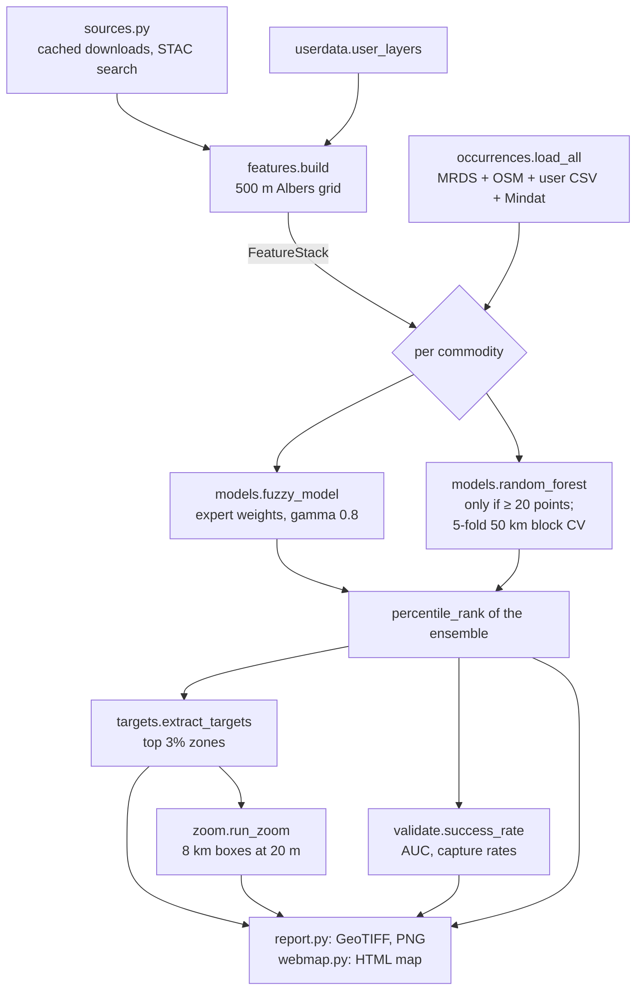

# zim-prospect architecture

`zim-prospect` is a batch pipeline. It turns open geoscience data into mineral-prospectivity
maps, ranked target zones and validation scores for Zimbabwe, and then into 10–20 m "where to
sample" maps inside the best targets. There is no server or database: every result is a file
(GeoTIFF, CSV, JSON, PNG or a self-contained HTML map).

This document is for developers changing the code. `README.md` covers using the tool,
`docs/CODEX_HANDOFF.md` covers deployment and the upgrade backlog, and `docs/research/` holds the
independent validation of the method and the use case.

---

## 1. System context

```mermaid
flowchart LR
  subgraph Open data
    GB[geoBoundaries<br/>border]
    USGS[USGS Africa geology<br/>+ MRDS mines]
    OSM[OpenStreetMap<br/>mines/quarries]
    DEM[Copernicus DEM<br/>GLO-90 / GLO-30 COGs]
    S2[Sentinel-2 L2A COGs<br/>Earth Search STAC]
  end
  subgraph Optional, user-supplied
    UD[data/user/<br/>geology, faults,<br/>rasters, mines CSV]
    MD[Mindat API<br/>MINDAT_API_KEY]
  end
  GB & USGS & OSM & DEM & S2 --> P[zimprospect pipeline]
  UD & MD --> P
  P --> O[(outputs/<br/>maps, targets, validation,<br/>HTML maps, zoom/)]
  O --> U[Analyst / prospector<br/>browser or QGIS]
```

Network use is read-only HTTPS. Large rasters are never downloaded whole: cloud-optimised GeoTIFFs
are read window by window, at the overview level that matches the grid resolution.

---

## 2. Commands and data flow

| Command | What it does | Main modules |
|---|---|---|
| `python -m zimprospect run` | Builds the feature stack, runs the models for every commodity, writes maps, targets, validation and the HTML map | `features`, `models`, `targets`, `report`, `webmap` |
| `python -m zimprospect zoom --commodity gold` | 10–20 m Sentinel-2 anomaly maps inside the top national targets | `zoom`, `webmap` |
| `python -m zimprospect tune` | Tunes the fuzzy weights with honest spatial cross-validation and writes `config/commodities.tuned.yaml` | `tuning` |



---

## 3. Module map

| Module | Responsibility | Key public API |
|---|---|---|
| `sources.py` | Every external download and search; caches raw files under `data/raw/` | `boundary()`, `geology()`, `mrds()`, `osm_mines()`, `cop_dem_urls()`, `s2_scenes()` |
| `grid.py` | The analysis grid (Albers equal-area, `ZIM_CRS`), rasterising, distances, sampling | `Grid`, `make_grid()`, `local_grid()`, `distance_km()`, `contact_cells()`, `lonlat_bounds()` |
| `features.py` | Builds the evidence-layer stack and caches it per resolution (`data/cache/*.npz`) | `FeatureStack`, `build()`, `warp_to_grid()`, `terrain_layers()`, `s2_indices()` |
| `s2.py` | Sentinel-2 settings, multi-season scene pooling and the tile-seam metric | `S2Settings`, `seam_score()` |
| `userdata.py` | Optional user geology, faults, rasters and occurrences (`data/user/`) | `load_config()`, `user_layers()`, `class_names()` |
| `mindat.py` | Optional Mindat localities (needs `MINDAT_API_KEY`) | `fetch_localities()` |
| `occurrences.py` | Known occurrences: MRDS + OSM (+ user CSV + Mindat), commodity matching, declustering | `load_all()`, `select()`, `decluster()` |
| `fuzzy.py` | Membership functions and the fuzzy gamma operator | `linear_decay()`, `class_lookup()`, `fuzzy_gamma()` |
| `models.py` | Evidence layers from config, fuzzy model, random forest with spatial CV, ranking | `evidence_layer()`, `fuzzy_model()`, `random_forest()`, `percentile_rank()`, `ensemble()` |
| `validate.py` | Success-rate curves and AUC against known points | `success_rate()`, `ValidationResult` |
| `targets.py` | Connected high-score zones, ranked, flagged greenfield or known district | `extract_targets()` |
| `tuning.py` | Fuzzy weight search scored on held-out spatial folds | `tune_commodity()`, `run_tuning()` |
| `zoom.py` | Target zoom: local grid, Sentinel-2 median composite, robust z-scores, anomaly patches | `run_zoom()`, `robust_z()`, `recipe_score()`, `anomaly_clusters()` |
| `report.py` | File outputs: GeoTIFFs, zoom PNGs, success curves, overview figure | `write_geotiff()`, `write_multiband()`, `success_curves()` |
| `webmap.py` + `web/` | Interactive HTML maps: shapes `ZP_DATA`, injects `web/map.css` and `web/map.js` into a Leaflet page | `national_map()`, `zoom_map()`, `write_page()` |
| `cli.py` | Argument parsing and orchestration of the three commands | `main()`, `run()` |

**Dependency direction:** `cli` → (`features`, `models`, `targets`, `tuning`, `zoom`, `report`, `webmap`) →
(`grid`, `fuzzy`, `validate`, `sources`). The lower layer never imports the upper one. `zoom` reuses
`features` (Sentinel-2 reading, terrain, index formulas), so the formulas live in one place.

---

## 4. Core data model

| Type | Fields | Notes |
|---|---|---|
| `Grid` (frozen) | `crs, transform, width, height, res_m, mask` | The national grid comes from `make_grid(border, 500)`. Zoom boxes use `local_grid(lat, lon, km, res)` with an all-True mask |
| `FeatureStack` (frozen) | `grid, layers: dict[str, ndarray]` | float32, NaN outside the study area |
| `S2Settings` (frozen) | `seasons, per_tile, max_cloud` | Part of the cache key, so changing it rebuilds only the Sentinel-2 layers |
| `RFResult` (frozen) | `full_map, oof_map, importances, n_positive` | `oof_map` holds out-of-fold predictions and is the only honest map to validate |
| `TuneResult` (frozen) | `prior_auc, tuned_auc, gain, accepted, weights, …` | Both AUCs come from held-out spatial folds |
| `ZoomResult` (frozen) | `rank, lat, lon, grid, indices, rgb, score, anomalies, n_scenes` | `score` is a robust z-score clipped to ±3 |

**Layer naming conventions** (the config refers to layers by name):

| Pattern | Meaning |
|---|---|
| `geo_class` | USGS age class: basement, karoo_lower, karoo_upper, karoo_volcanic, cover, water. Config uses `layer: geo` |
| `dist_*` | Distance in km (for example `dist_karoo_margin`, `user_dist_fault`) |
| `elev`, `slope`, `rough` | Copernicus DEM |
| `s2_ferric`, `s2_ferrous`, `s2_clay`, `s2_ndvi`, `s2_albedo` | Dry-season Sentinel-2 median indices |
| `<layer>_ctx5`, `<layer>_ctx15` | NaN-aware neighbourhood mean at 5 and 15 km |
| `user_*` | User-supplied layers. `user_lith` is a class layer; every other `user_*` layer is continuous and joins the random forest automatically |

---

## 5. Modelling decisions

| Decision | Why |
|---|---|
| **Open data only, no API keys by default** | Anyone can rerun it. Keyed or private sources (Mindat, ZGS) are optional plug-ins |
| **Albers equal-area grid centred on Zimbabwe** | Areas (success-rate curves) and distances (buffers) stay true across the country |
| **Two models: fuzzy (knowledge) + random forest (data)** | Fuzzy works for every commodity, even with 5 known sites. The random forest adds data-driven fit where there are at least 20 sites |
| **The final map is a true percentile rank** | Fuzzy and random forest scores are not comparable, but ranks are. The ensemble (mean of ranks) is re-ranked, so 0.9 means "top 10% of the country". The method-validation agent found that this was missing |
| **5-fold spatial block cross-validation (50 km blocks)** | Neighbouring cells are near-duplicates, so a random split leaks. Each reported score comes from a model that never saw that region |
| **Validation = success-rate AUC + capture in the top 10%** | Easy to read: "flag X% of the country, catch Y% of known deposits" |
| **Targets = connected top-3% zones** | Gives a short ranked list instead of a heat map. "Greenfield" means more than 5 km from any *recorded* site |
| **Zoom = robust z-scores within each box** | Being relative to the local background cancels most tile and illumination differences. MAD is robust to the anomalies themselves |
| **Static HTML maps, no server** | Works offline, can be sent as a file, and adds no attack surface. Shareable state (selected mineral) lives in the URL hash |

Section 3 of `docs/CODEX_HANDOFF.md` sets out the precision limits: 500 m national, 10–20 m zoom, metres only
with field work.

---

## 6. Storage layout and configuration

```
data/raw/      cached downloads (border, USGS geology, MRDS, OSM, Mindat)    ← ZIMPROSPECT_DATA_DIR
data/cache/    feature stacks per resolution and S2 settings (*.npz + grid json)
data/user/     optional user data: geology.gpkg, faults.gpkg, rasters/*.tif, occurrences.csv
outputs/       maps/*.tif, targets_*.csv, validation.json, *.png, *.html, zoom/  ← ZIMPROSPECT_OUT_DIR
config/commodities.yaml        evidence weights, zoom recipes, model settings
config/user_data.yaml          optional mapping of user geology units to lith classes (see the .example)
config/commodities.tuned.yaml  written by `tune`; never overwrites the expert config
baselines/                     reference validation scores for regression checks
```

Nothing under `data/`, `outputs/` or `logs/` is committed. User data may be licensed.

**Adding a commodity:** add a block under `commodities:` with `label`, `match` words, `evidence`
entries and, optionally, a `zoom` recipe. No code change is needed.

**Adding an evidence layer:** add a builder to `features.BUILDERS`, or drop a GeoTIFF in
`data/user/rasters/` and it becomes `user_<name>`. Then reference it from the config.

---

## 7. Interactive map architecture

```
webmap.py ──shapes──► ZP_DATA (JSON)  ─┐
web/map.css (tokens, explorer panel)   ├─► one HTML file (folium/Leaflet scaffold)
web/map.js  (panel, sheet, layers)    ─┘
```

- **One page design for both maps.** The national map shows minerals with their targets; the zoom map
  shows targets with their anomalies. Both use the same `ZP_DATA` contract:
  `groups[] = {key, short, name, desc, badge, stats, image, bounds, points[], context[]}`.
- **Geographic context.** A simplified copy of the analysis boundary is embedded as GeoJSON, with a dark casing
  and white outline above the heat overlay. Country bounds drive the national reset action.
- **Layout.** Desktop gets an opaque dark explorer panel with a native mineral selector and Targets,
  Compare and Map & legend tabs. The target list supports filtering, sorting and a per-mineral shortlist of up
  to three zones. Numeric comparison values come from the target CSV fields; distances describe the zone.
  Phones (< 768 px) get a labelled bottom sheet with 1:1 drag,
  momentum projection and a critically damped spring that starts from the live position, so it can be
  interrupted. Only one group shows at a time, and the heat layer cross-fades on switch.
- **Security.** All text from open data (OSM names, MRDS fields) is inserted with `textContent`, never
  `innerHTML`. The JSON payload escapes `</` and U+2028/2029. External links use `rel="noopener noreferrer"`.
- **Accessibility.** Mineral selection uses a native select, tabs have arrow-key support, and list rows are buttons with full labels.
  Comparison checkboxes have target-specific labels, and comparison tables have row and column headers.
  Changes are announced through an `aria-live` region. Touch targets are 44 px, focus is visible, and the page respects
  `prefers-reduced-motion` and `prefers-contrast`. The panel uses an opaque surface.

---

## 8. Quality gates

- `pytest -q`: unit tests. Network tests are marked `network` and skipped by default.
- `scripts/compare_validation.py baselines/<file>.json outputs/validation.json` fails if any commodity's AUC
  drops by more than 0.02.
- `docs/research/method-validation.md`: an independent holdout of 45 literature-named mines and
  goldfields that the model never trained on. Gold, chromite and PGM maps put 96%, 90% and 80% of them in their
  top 10% (random: 23–29%). The weakness is target *ranking*, which follows rugged terrain.
- `docs/research/use-case-validation.md`: who the tool is for (desk screening and claim due diligence first)
  and what to build next.

## 9. Known limitations

1. **Lithology.** No open map separates greenstone from granite, and no open Great Dyke polygon exists. Supplying ZGS
   geology through `data/user/` is the fix.
2. **Magnetics.** EMAG2 has a gap over Zimbabwe. The use-case research found 1980s Zimbabwe aeromagnetic surveys
   listed by Natural Resources Canada under an open licence; whether the grids can be downloaded is unconfirmed.
3. **Occurrences.** The occurrence data is sparse and biased toward roads and the highveld. The method review recommends adding the
   GeoNames mine gazetteer (about 670 mines) as training data and as a target-group background.
4. **Target ranking.** Terrain roughness pulls targets onto escarpments. The method review recommends making terrain
   evidence conditional on lithology.
5. **Satellites see only the surface.** Zoom anomalies are places to sample, not deposits.
